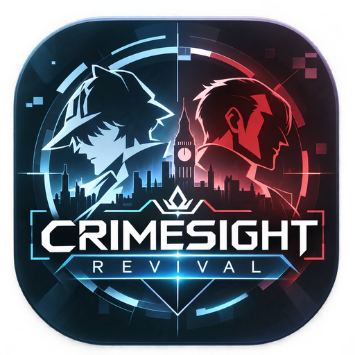
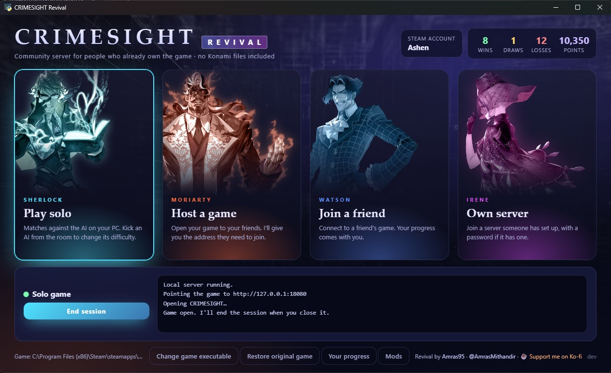
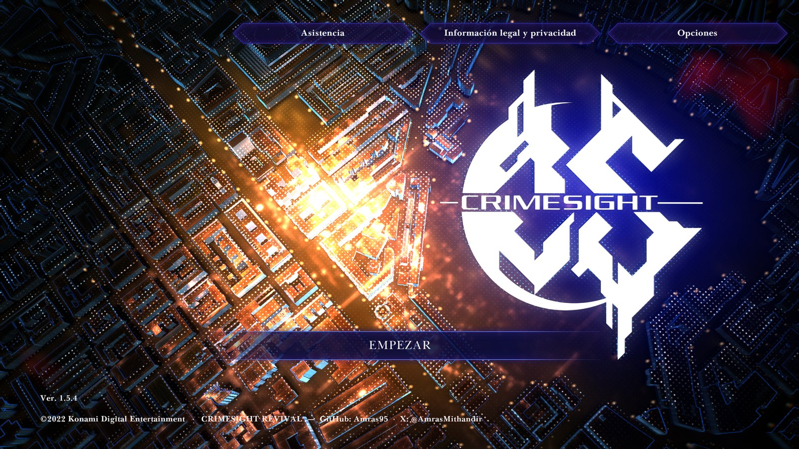
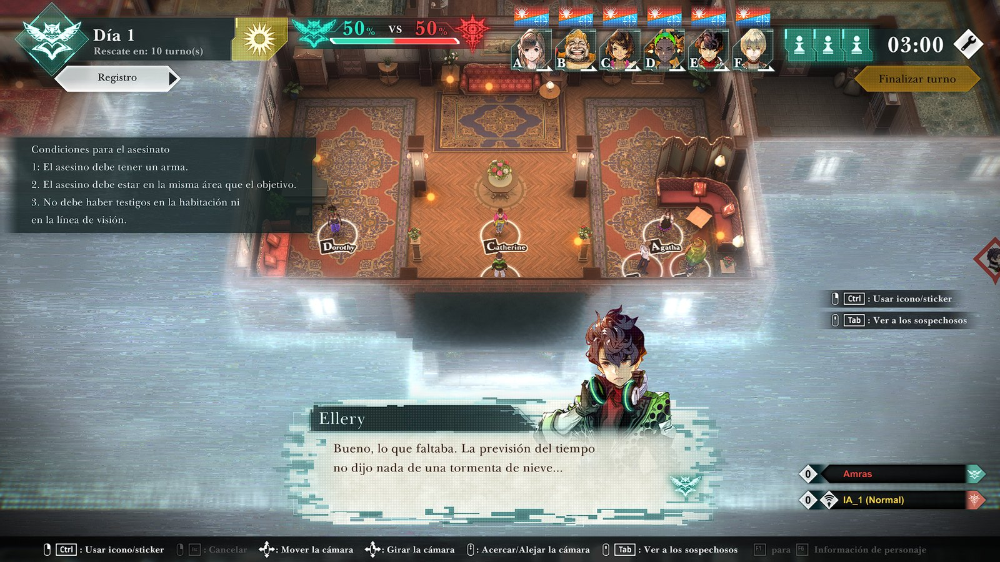

<h1 align="center">CRIMESIGHT Revival</h1>

<a href="README.md">Español</a> · <b>English</b>

Play CRIMESIGHT (Konami, 2022) again after its official servers shut down.

<a href="https://github.com/Amras95/crimesight-revival/releases/latest"><b>⬇ Download</b></a> ·
<a href="https://ko-fi.com/amrasmithandir95">☕ Ko-fi</a>

---

> [!NOTE]
> **Tested and working:** solo matches against the AI and matches between two people (host and friend),
> including over Radmin VPN.
>
> **Not tested with people yet:** matches with **Watson** or **Irene** (3 or 4 players) and own servers on
> a VPS. They should work, but if you run into any problem, please report it in
> [Issues](https://github.com/Amras95/crimesight-revival/issues) and I'll fix it.

- Community project, unofficial and non-profit. Not affiliated with Konami.
- **You need to own CRIMESIGHT in your Steam library.** No game files, keys or images are included
  here: everything is read from your own installation.
- **This project only publishes the tool.** It does not run or host any servers: each player or group
  of friends runs their own. If someone runs one, they should not charge for access.
- Everything can be undone with the "Restore original game" button.

## How to play (step by step)

1. Have **CRIMESIGHT installed** from Steam and **Steam running** with your account.
2. Download **`CrimeSightRevival.exe`** from [the latest release](https://github.com/Amras95/crimesight-revival/releases/latest).
3. Open it. The first time, it takes a few seconds to prepare the keys and artwork from your copy of the
   game. If Windows SmartScreen warns you ("Windows protected your PC"), click *More info* →
   *Run anyway*: this happens with any new program that doesn't have a paid signature.
4. Choose how to play:

   | Option | What it does |
   |---|---|
   | **Play solo** | Matches against the AI on your PC. |
   | **Host a game** | Your friends connect to your PC. The launcher tries to open your router's port and gives you the address to share. |
   | **Join a friend** | Enter the address your host friend gives you. |
   | **Own server** | Join a server someone has set up, with a password if it has one. |

5. Press the button and the game opens by itself. When you close the game, the session ends.

The launcher **updates itself** whenever a new version is released, and it shows up in the language
your game is set to (all 11 of the game's languages).

### In the room

- Empty seats are filled with **AI** (`AI_1 (Normal)`…). **Kick an AI** to change its difficulty:
  Normal → Hard → Easy → empty seat for a friend.
- When a friend joins, they take an AI's seat.

### If your friend can't get in

When you host, your router has to let port **18080 (TCP)** through. The launcher tries to do this by
itself (UPnP); if your router doesn't allow it:

- Open it manually in your router settings (forward port 18080 TCP to your PC's IP), **or**
- Use a free private network such as **Radmin VPN** (the simplest), **Tailscale** or **ZeroTier**, and give your friend
  the IP that network assigns you (for example `100.64.1.2:18080`).

### Your progress

Your matches, wins and points are saved **on your PC** (`%APPDATA%\CrimeSightRevival`), not in the game
folder: even if you uninstall or reinstall the game, you lose nothing. When you play on a friend's server,
your progress is merged with theirs when you join and comes back to your PC when you leave: nothing is
ever duplicated or lost.

With the launcher's **"Your progress"** button you can:

- **Export / import** it as a `.csrsave` file to take it to another PC. Importing only adds the matches
  you're missing, so nothing is ever duplicated.
- Turn on **automatic backup** to a OneDrive, Google Drive or Dropbox folder: a copy is saved after every
  session and, on another PC, your progress comes back by itself when you choose the same folder.

Steam Cloud isn't used, because each game's cloud storage is controlled by its publisher.

## What works

- Sign-in, profile, tutorial, settings and level.
- Rooms for 2 to 4 players mixing people and AI (tested with 2 people; with human Watson/Irene,
  **not tested yet**). AI for all
  four roles (Sherlock, Moriarty, Watson and Irene), with three difficulty levels.
- Full matches: items, wild dogs, gas leaks, Assault, final turn, murder, arrest and final deduction,
  with the right cutscene for each side.
- Wins, draws, losses and points. A win gives 200 against easy AI, 400 on normal, 800 on hard and 1000
  against other people; a draw or loss gives half; quitting gives 0. Action bonuses: repairing the fuse box
  (+50), healing (+50), foiling the Assault (+100), tear gas on the villain (+100) and naming the villain
  (+100); as Moriarty, killing with the Assault (+50), causing the blackout (+50), gassing someone (+50) and
  knocking out the target (+100).
- Point and level rewards as in the original. The Project Winter event stays open with its avatar
  unlocked. Deluxe content still depends on owning it on Steam.
- Steam achievements can still be earned (the game itself handles them with Steam).

## Platforms

CRIMESIGHT was only released for **Windows 10/11 (64-bit)**, and the launcher is Windows-only too.
On Linux / Steam Deck the game might run through Proton, but neither the game nor this launcher has
been tested there. There is no Mac version of the game.

## Running a server (for example, on a VPS)

1. On your PC, with the game installed: `python tools/extract_keys.py "<game folder>"`. This creates
   `server/keys.json` with the keys from **your** copy. Upload it to the server together with the
   `server/` folder.
2. On the server (Python 3.10+): `pip install aiohttp pycryptodome` and
   `python server.py --password A_PASSWORD` (port 18080; open it in the firewall).
3. Players use "Own server" with `IP_OR_DOMAIN:18080` and the password.

The password protects profile sync: the game only identifies itself with its Steam ID, so a server
without a password would let anyone pretend to be another player.

## For developers

- `4_lanzador.bat`: opens the launcher with Python, without building.
- `crear_exe.bat`: builds `dist\CrimeSightRevival.exe` (development build, does not update itself).
- Every push to `main` makes GitHub Actions build the `.exe` on Windows and publish a release
  (`.github/workflows/release.yml`). Installed launchers download it, check its SHA-256 hash and
  replace themselves.
- Scripts without the launcher: `1_preparar.bat` (dependencies, keys and redirect), `2_servidor.bat` and
  `3_restaurar_juego_original.bat`.

### How it works inside

Unity 2020.3 with IL2CPP. The server address (`https://cott-game.cs.konami.net`) is changed in
`global-metadata.dat`. Traffic is encrypted with AES-256-CBC; the keys are in the game's own
`resources.assets`. The API is `POST /cott/api/index.php` and matches run over WebSocket with WAMP v2:
the server drives the turn phases, hands out items and decides hazards and murders; the visual
simulation runs on the client. Community server extras: `POST /revival/sync` (profiles) and
`GET /revival/info`.

## License

[GPL-3.0](LICENSE) with [additional terms](ADDITIONAL_TERMS.md) (section 7): attribution to the author
must be kept, and modified versions must say so and must not pass themselves off as the original.

## Credits

CRIMESIGHT Revival by **Amras95** · [GitHub](https://github.com/Amras95) · [X](https://x.com/AmrasMithandir) ·
[Ko-fi](https://ko-fi.com/amrasmithandir95)

The launcher icon is an original design made for this project. CRIMESIGHT is a trademark of Konami
Digital Entertainment; this project is not affiliated with or endorsed by Konami.

## Notice

Preservation project for people who bought the game. If Konami asks for it to be taken down, it will be.
