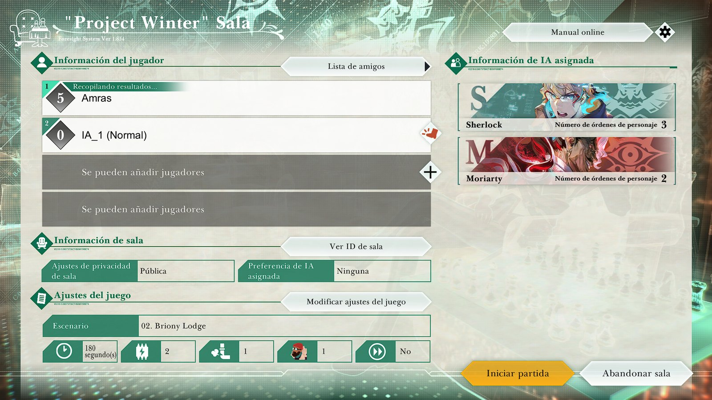

<p align="center"></p>

<h1 align="center">CRIMESIGHT Revival</h1>

<p align="center"><a href="README.md">Español</a> · <b>English</b></p>

<p align="center">
Play CRIMESIGHT (Konami, 2022) again after its official servers shut down.
</p>

<p align="center">
<a href="https://github.com/Amras95/crimesight-revival/releases/latest"><b>⬇ Download</b></a> ·
<a href="https://ko-fi.com/amrasmithandir95">☕ Ko-fi</a>
</p>


<p align="center">

</p>

<p align="center">



</p>

---

> [!NOTE]
> **Tested and working:** solo matches against the AI and matches between two people (host and friend),
> including over Radmin VPN.
>
> **Sticker and avatar mods:** tested solo, with and without hot reload. Downloading the host's mods when
> joining their room is tested locally, not yet between two people.
>
> **Scenario creator (new in 1.1):** tested solo. Sharing scenarios with the room hasn't been tested
> between two people yet.
>
> **Linux / Steam Deck:** new build, still being tested.
>
> **Not tested with people yet:** matches with **Watson** or **Irene** (3 or 4 players) and own servers on
> a VPS. They should work, but if you run into any problem, please report it in
> [Issues](https://github.com/Amras95/crimesight-revival/issues) and I'll fix it.

- Community project, unofficial and non-profit. Not affiliated with Konami.
- **You need to own CRIMESIGHT in your Steam library.** No game files, keys or images are included
  here: everything is read from your own installation.
- **This project only publishes the tool.** It does not run or host any servers: each player or group
  of friends runs their own. If someone runs one, they should not charge for access.
- Everything can be undone with the "Restore original game" button.

## How to play (step by step)

1. Have **CRIMESIGHT installed** from Steam and **Steam running** with your account.
2. Download **`CrimeSightRevival.exe`** from [the latest release](https://github.com/Amras95/crimesight-revival/releases/latest).
3. Open it. The first time, it takes a few seconds to prepare the keys and artwork from your copy of the
   game. If Windows SmartScreen warns you ("Windows protected your PC"), click *More info* →
   *Run anyway*: this happens with any new program that doesn't have a paid signature.
4. Choose how to play:

   | Option | What it does |
   |---|---|
   | **Play solo** | Matches against the AI on your PC. |
   | **Host a game** | Your friends connect to your PC. The launcher tries to open your router's port and gives you the address to share. |
   | **Join a friend** | Enter the address your host friend gives you. |
   | **Own server** | Join a server someone has set up, with a password if it has one. |

5. Press the button and the game opens by itself. When you close the game, the session ends.

When a new version is released, the launcher **tells you on launch**, shows what's new and lets you
decide whether to update right then or later (a notice stays next to the version number). To play with
other people, it's best that everyone has the same version. The launcher shows up in the language your
game is set to (all 11 of the game's languages).

### In the room

- Empty seats are filled with **AI** (`AI_1 (Normal)`…). **Kick an AI** to change its difficulty:
  Normal → Hard → Easy → empty seat for a friend.
- When a friend joins, they take an AI's seat.

### If your friend can't get in

When you host, your router has to let port **18080 (TCP)** through. The launcher tries to do this by
itself (UPnP); if your router doesn't allow it:

- Open it manually in your router settings (forward port 18080 TCP to your PC's IP), **or**
- Use a free private network such as **Radmin VPN** (the simplest), **Tailscale** or **ZeroTier**, and give your friend
  the IP that network assigns you (for example `100.64.1.2:18080`).

### Your progress

Your matches, wins and points are saved **on your PC** (`%APPDATA%\CrimeSightRevival`), not in the game
folder: even if you uninstall or reinstall the game, you lose nothing. When you play on a friend's server,
your progress is merged with theirs when you join and comes back to your PC when you leave: nothing is
ever duplicated or lost.

With the launcher's **"Your progress"** button you can:

- **Export / import** it as a `.csrsave` file to take it to another PC. Importing only adds the matches
  you're missing, so nothing is ever duplicated.
- Turn on **automatic backup** to a OneDrive, Google Drive or Dropbox folder: a copy is saved after every
  session and, on another PC, your progress comes back by itself when you choose the same folder.

Steam Cloud isn't used, because each game's cloud storage is controlled by its publisher.

## Mods: your own stickers and avatars

Add your own stickers and avatars. **They're new slots**: the game's own ones (including the paid ones, which
still depend on owning them on Steam) are never changed.

1. In the launcher, click **Mods → Open mods folder** (`%APPDATA%\CrimeSightRevival\mods`). It comes ready
   with an example mod and a `README.txt`.
2. Put your images (PNG, JPG, WEBP…) in `stickers\` and/or `avatars\`. You can put them straight into the
   mods folder or make one folder per mod (**New mod** button) to keep several packs.
3. Play. The launcher adds them to the game before opening it.

```
mods\
  stickers\        01_hello.png, Good night!.png…
  avatars\         me.png
  Cats\            another mod: its own stickers\ and avatars\ folders (+ optional mod.json)
```

- **Any image works.** They're adjusted to the game's size automatically (128×128 stickers with their white
  border; 256×256 avatars placed like the original ones). A **sheet with many stickers** in a grid is split
  automatically, and images without transparency get their background removed. Avatars that reach the edges
  (a cropped bust, a photo) go inside a circle so they fit every frame.
- **The sticker's message** (what shows in the log: "Amras: Good night!") is the file name; a number at the
  start (`01_`) only sets the order. To use characters Windows doesn't allow in file names (`? : " *`), type
  it in **Mods → Messages**. It's saved in the mod's `mod.json`.
- **Turn each mod on or off** from the Mods window.
- **In another player's room**, before joining you get a notice with their mods: **Download and join** or
  **Don't join**. They're downloaded as temporary mods (`<id>+temp`), your own mods are paused during the
  match, and when you leave the temporary ones are deleted and yours come back. If the room has no mods, you
  join without any: every player must have exactly the same list.
- Whatever you have on your sticker wheel and your chosen avatar **are kept** when you add images, change
  messages or the launcher updates. A sticker is only removed if you delete or rename its image (the game
  puts "Hello!" in its slot).

### Hot reload (optional, with BepInEx)

By default, changing mods needs a game restart. If you want changes to appear **while the game is open**,
click **Mods → Hot reload → Turn on**:

- The launcher downloads [BepInEx](https://github.com/BepInEx/BepInEx) (the official mod loader for Unity
  games, 34 MB) **from its GitHub, and only if you turn it on**: it's not bundled. It installs it in the game
  folder together with the project's plugin. The first game start takes about a minute while BepInEx sets up.
- While you play, the launcher watches your mods folder: if you add an image, change a message or turn a mod
  on/off, it shows up in the game within seconds. If you're the host, your room gets it too; if you're in
  someone else's room, you get their changes.
- Changes are never applied mid-match (they wait for the menu), so everyone keeps the same list.
- **Remove BepInEx** (or "Restore original game") deletes everything and the game is back to normal.

## Scenario creator

**Mods → Scenario creator** lets you rearrange the rooms of one of the game's scenarios and save it as a
new one. The original scenarios are never changed. Playing them needs hot reload.

- Move, rotate, remove or repeat rooms; swap doors for furniture or secret passages; choose which windows
  the wild dogs come in through, where the gas is and where the characters start. The creator warns you
  about anything that would stop the scenario from being playable, and "Quick test" shows it in the game
  without saving.
- Each saved scenario shows up in the game's scenario list with its name. You can save as many as you like
  and have up to 20 turned on at once; the ones turned off keep their design.
- **Export / Import** shares them as `.csrstage` files. They only hold the room layout: nothing from the game.
- In a room, everyone downloads the host's scenarios when joining. With a custom scenario selected, the
  match can't start until everyone has it: the name of whoever is missing it says so ("loading stage…", or
  "stage missing" if they don't have hot reload).
- The creator reads the rooms from **your** copy of the game; the project ships none.

## What works

- Sign-in, profile, tutorial, settings and level.
- Rooms for 2 to 4 players mixing people and AI (tested with 2 people; with human Watson/Irene,
  **not tested yet**). AI for all
  four roles (Sherlock, Moriarty, Watson and Irene), with three difficulty levels.
- Full matches: items, wild dogs, gas leaks, Assault, final turn, murder, arrest and final deduction,
  with the right cutscene for each side.
- Wins, draws, losses and points. A win gives 200 against easy AI, 400 on normal, 800 on hard and 1000
  against other people; a draw or loss gives half; quitting gives 0. Action bonuses: repairing the fuse box
  (+50), healing (+50), foiling the Assault (+100), tear gas on the villain (+100) and naming the villain
  (+100); as Moriarty, killing with the Assault (+50), causing the blackout (+50), gassing someone (+50) and
  knocking out the target (+100).
- Point and level rewards as in the original. The Project Winter event stays open with its avatar
  unlocked. Deluxe content still depends on owning it on Steam.
- Steam achievements can still be earned (the game itself handles them with Steam).
- New sticker and avatar mods, shared with the room, with optional hot reload.
- Scenario creator, with scenarios shared with the room.
- The AI players answer your stickers with a random one.
- Controller support (Xbox, PlayStation, Switch, Steam Deck) with hot reload turned on. The button layout
  is in the [wiki](https://github.com/Amras95/crimesight-revival/wiki/Controller).

## Platforms

CRIMESIGHT was only released for **Windows 10/11 (64-bit)**. There is no Mac version of the game.

### Linux / Steam Deck (testing)

The game runs through **Proton**, and there's a Linux build of the launcher: **`CrimeSightRevival-linux`**
in [the latest release](https://github.com/Amras95/crimesight-revival/releases/latest).

1. Download it, make it executable (right click → Properties → "Is executable", or
   `chmod +x CrimeSightRevival-linux`) and open it. On Steam Deck, from **Desktop Mode**.
2. The interface opens in your **web browser** (it's the same one as on Windows). The launcher keeps
   running while the tab is open; if you close it with no match running, it closes by itself.
3. It finds Steam and the game on its own (regular Steam, Flatpak or Snap) and starts the game through
   Steam with Proton.

Mods work the same. For **hot reload** (BepInEx) you also need to add this to CRIMESIGHT's **launch
options** in Steam (Properties → General); the launcher tells you if it's missing:

```
WINEDLLOVERRIDES="winhttp=n,b" %command%
```

## Running a server (for example, on a VPS)

1. On your PC, with the game installed: `python tools/extract_keys.py "<game folder>"`. This creates
   `server/keys.json` with the keys from **your** copy. Upload it to the server together with the
   `server/` folder.
2. On the server (Python 3.10+): `pip install aiohttp pycryptodome` and
   `python server.py --password A_PASSWORD` (port 18080; open it in the firewall).
3. Players use "Own server" with `IP_OR_DOMAIN:18080` and the password.
4. Optional: `--mods-dir FOLDER` offers players the mods in that folder (same layout as the launcher's mods
   folder; needs `pip install pillow`).
5. Optional: `--stages-dir FOLDER` offers players the scenario-creator scenarios in that folder (the `.json`
   files from `%APPDATA%\CrimeSightRevival\stages`).

The password protects profile sync: the game only identifies itself with its Steam ID, so a server
without a password would let anyone pretend to be another player.

## For developers

- `4_lanzador.bat`: opens the launcher with Python, without building.
- `plugin/`: source of the optional BepInEx plugin and its compiled `.dll`. It's built against the assemblies
  BepInEx 6 (IL2CPP) generates in `BepInEx\interop` on the first game start; no game files are included.
- `crear_exe.bat`: builds `dist\CrimeSightRevival.exe` (development build, does not update itself).
- `CHANGELOG.md`: what's new in each version. Its first block is what the launcher shows when it offers an
  update, if the file changes in the push; otherwise it shows the commit message.
- Every push to `main` makes GitHub Actions build the `.exe` on Windows and publish a release
  (`.github/workflows/release.yml`). Installed launchers download it, check its SHA-256 hash and
  replace themselves.
- Scripts without the launcher: `1_preparar.bat` (dependencies, keys and redirect), `2_servidor.bat` and
  `3_restaurar_juego_original.bat`.

### How it works inside

Unity 2020.3 with IL2CPP. The server address (`https://cott-game.cs.konami.net`) is changed in
`global-metadata.dat`. Traffic is encrypted with AES-256-CBC; the keys are in the game's own
`resources.assets`. The API is `POST /cott/api/index.php` and matches run over WebSocket with WAMP v2:
the server drives the turn phases, hands out items and decides hazards and murders; the visual
simulation runs on the client. Community server extras: `POST /revival/sync` (profiles), `GET /revival/info`
and `GET /revival/mods` (the room's mod pack).

**Mods (`server/modpack.py`, `server/modimage.py`, `launcher/modinject.py`):**

- Stickers are `StampData` objects in `resources.assets`; the free ones are in `StampSet` 0. The game
  identifies them by `type | face` and sends their **position** in the list over the network (`setIndex`,
  `dataIndex`), so every player in the room needs the same list in the same order. Each new sticker gets a
  type from 1000 to 4095 (the game uses 0-38) computed from the mod folder and the file name, so it's stable
  and the order (the game sorts by type) comes out the same on every PC.
- Avatars are `CursorAvatarData` objects in `sharedassets3.assets`, listed by the `CursorAvatarSet`s of the
  `level3` (menu) and `level4` (match) scenes; over the network they travel by name (`Icon_CSR_<hash>`).
- **Without BepInEx**, `modinject.py` rebuilds those files with UnityPy, always starting from the originals
  (`*.original`): it clones a template `StampData`/`CursorAvatarData`, adds an embedded RGBA32 texture and a
  4-vertex sprite, and appends them to the lists. Messages are added to the game's text (`ctg_name`, in all
  11 languages). If the saved wheel or avatar (PlayerPrefs) point to a mod that's gone, they're replaced with
  one of the game's.
- **With BepInEx**, the game files stay original: the launcher writes the room's set to
  `BepInEx\csr_live\live.json` (in the game folder) and the plugin (`plugin/CrimeSightRevivalMods.cs`) creates
  the objects in memory (`Texture2D` + `Sprite.Create` + `ScriptableObject.CreateInstance`), adds them to the
  game's lists and adds the texts to `TextManager.LangText`. It checks every second and reapplies after every
  scene change.
- Over the network, an internal zip carries the already adjusted and validated images (size, names, format):
  players never have to compress anything.

## License

[GPL-3.0](LICENSE) with [additional terms](ADDITIONAL_TERMS.md) (section 7): attribution to the author
must be kept, and modified versions must say so and must not pass themselves off as the original.

## Credits

CRIMESIGHT Revival by **Amras95** · [GitHub](https://github.com/Amras95) · [X](https://x.com/AmrasMithandir) ·
[Ko-fi](https://ko-fi.com/amrasmithandir95)

The launcher icon is an original design made for this project. CRIMESIGHT is a trademark of Konami
Digital Entertainment; this project is not affiliated with or endorsed by Konami.

## Notice

Preservation project for people who bought the game. If Konami asks for it to be taken down, it will be.
