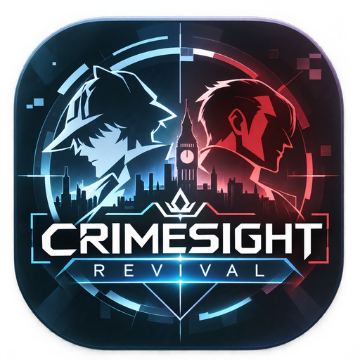

<h1 align="center">CRIMESIGHT Revival</h1>

<b>Español</b> · <a href="README.en.md">English</a>

Vuelve a jugar a CRIMESIGHT (Konami, 2022) después del cierre de sus servidores oficiales. 
Play CRIMESIGHT (Konami, 2022) again after its official servers shut down.

<a href="https://github.com/Amras95/crimesight-revival/releases/latest"><b>⬇ Descargar / Download</b></a> ·
<a href="https://ko-fi.com/amrasmithandir95">☕ Ko-fi</a>

---

> [!WARNING]
> **Las funciones online todavía no se han probado.** Jugar solo contra la IA está probado y funciona.
> Ser anfitrión, unirse a un amigo, el servidor propio, la sincronización del progreso y la apertura
> automática del puerto (UPnP) están hechos, pero aún no se han probado entre dos PCs reales: falta poder
> jugar con alguien o que dos personas lo prueben. Si lo probáis, contadme qué tal en
> [Issues](https://github.com/Amras95/crimesight-revival/issues).

- Proyecto de la comunidad, no oficial y sin ánimo de lucro. No está relacionado con Konami.
- **Necesitas tener CRIMESIGHT en tu biblioteca de Steam.** Aquí no se incluye ningún archivo, clave ni
  imagen del juego: todo se lee de tu propia instalación.
- **Este proyecto solo publica la herramienta.** No gestiona ni aloja servidores: cada jugador o grupo de
  amigos monta el suyo. Si alguien monta uno, que no cobre por entrar.
- Todo se puede deshacer con el botón «Dejar el juego original».

## Cómo jugar (paso a paso)

1. Ten **CRIMESIGHT instalado** desde Steam y **Steam abierto** con tu cuenta.
2. Descarga **`CrimeSightRevival.exe`** desde [la última versión](https://github.com/Amras95/crimesight-revival/releases/latest).
3. Ábrelo. La primera vez tarda unos segundos en preparar las claves y las ilustraciones a partir de tu
   copia del juego. Si Windows SmartScreen avisa ("Windows protegió su PC"), pulsa *Más información* →
   *Ejecutar de todas formas*: pasa con cualquier programa nuevo sin firma de pago.
4. Elige cómo jugar:

   | Opción | Para qué |
   |---|---|
   | **Jugar solo** | Partidas contra la IA en tu PC. |
   | **Ser anfitrión** | Tus amigos se conectan a tu PC. El lanzador intenta abrir el puerto del router y te da la dirección para pasársela. |
   | **Unirme a un amigo** | Escribes la dirección que te pase tu amigo anfitrión. |
   | **Servidor propio** | Entras en un servidor que haya montado alguien, con contraseña si la tiene. |

5. Pulsa el botón y el juego se abre solo. Al cerrar el juego, termina la sesión.

El lanzador se **actualiza solo** cada vez que se publica una versión nueva, y se muestra en el idioma
en que tienes el juego (los 11 idiomas del juego).

### En la sala

- Los huecos libres se llenan con **IA** (`IA_1 (Normal)`…). **Expulsa a una IA** para cambiar su
  dificultad: Normal → Difícil → Fácil → hueco libre para un amigo.
- Cuando entra un amigo, ocupa el sitio de una IA.

### Si tu amigo no puede entrar

Cuando eres anfitrión, tu router tiene que dejar pasar el puerto **18080 (TCP)**. El lanzador lo intenta
solo (UPnP); si tu router no lo permite:

- Ábrelo a mano en la configuración del router (reenviar el puerto 18080 TCP a la IP de tu PC), **o**
- Usad una red privada gratuita como **Tailscale**, **ZeroTier** o **Radmin VPN**, y pásale a tu amigo la
  IP que te dé esa red (por ejemplo `100.64.1.2:18080`).

### Tu progreso

Tus partidas, victorias y puntos se guardan **en tu PC** (`%APPDATA%\CrimeSightRevival`), no en la carpeta
del juego: aunque lo desinstales o reinstales, no pierdes nada. Cuando juegas en el servidor de un amigo,
tu progreso se junta con el suyo al entrar y vuelve a tu PC al salir: nunca se duplica ni se pierde nada.

Con el botón **«Tu progreso»** del lanzador puedes:

- **Exportarlo / importarlo** en un archivo `.csrsave` para llevarlo a otro PC. Importar solo suma las
  partidas que falten, así que nunca duplica nada.
- Activar la **copia automática** en una carpeta de OneDrive, Google Drive o Dropbox: se guarda una copia
  al terminar cada sesión y, en otro PC, tu progreso vuelve solo al elegir la misma carpeta.

Steam Cloud no se usa porque el espacio en la nube de cada juego lo controla su editora.

## Qué funciona

- Inicio de sesión, perfil, tutorial, ajustes y nivel.
- Salas de 2 a 4 jugadores mezclando personas e IA (con varias personas: **pendiente de probar**). IA para los cuatro papeles (Sherlock, Moriarty,
  Watson e Irene), con tres dificultades.
- Partidas completas: objetos, perros salvajes, escapes de gas, Asalto, turno final, asesinato,
  detención y deducción final, con la cinemática correcta para cada bando.
- Victorias, empates, derrotas y puntos: 250 por partida completada, +150 por ganar, 0 si abandonas.
- Recompensas por puntos y nivel como en el original. El evento Project Winter queda abierto con su
  avatar desbloqueado. El contenido Deluxe sigue dependiendo de tenerlo en Steam.
- Los logros de Steam se siguen consiguiendo (los gestiona el propio juego con Steam).

## Plataformas

CRIMESIGHT solo salió para **Windows 10/11 (64 bits)**, y el lanzador también es para Windows.
En Linux / Steam Deck el juego podría funcionar con Proton, pero ni el juego ni este lanzador están
probados ahí. En Mac no hay versión del juego.

## Montar un servidor (por ejemplo, en un VPS)

1. En tu PC, con el juego instalado: `python tools/extract_keys.py "<carpeta del juego>"`. Crea
   `server/keys.json` con las claves de **tu** copia. Súbelo al servidor junto con la carpeta `server/`.
2. En el servidor (Python 3.10+): `pip install aiohttp pycryptodome` y
   `python server.py --password UNA_CONTRASEÑA` (puerto 18080; ábrelo en el cortafuegos).
3. Los jugadores usan «Servidor propio» con `IP_O_DOMINIO:18080` y la contraseña.

La contraseña protege la sincronización de perfiles: el juego solo se identifica con su ID de Steam,
así que un servidor sin contraseña permitiría a cualquiera hacerse pasar por otro jugador.

## Para desarrolladores

- `4_lanzador.bat`: abre el lanzador con Python, sin compilar.
- `crear_exe.bat`: crea `dist\CrimeSightRevival.exe` (versión de desarrollo, no se actualiza sola).
- Cada vez que se sube algo a `main`, GitHub Actions compila el `.exe` en Windows y publica una release
  (`.github/workflows/release.yml`). Los lanzadores instalados la descargan, comprueban su huella
  SHA-256 y se sustituyen solos.
- Scripts sin lanzador: `1_preparar.bat` (dependencias, claves y redirección), `2_servidor.bat` y
  `3_restaurar_juego_original.bat`.

### Cómo funciona por dentro

Unity 2020.3 con IL2CPP. La dirección del servidor (`https://cott-game.cs.konami.net`) se cambia en
`global-metadata.dat`. El tráfico va cifrado con AES-256-CBC; las claves están en `resources.assets` del
propio juego. La API es `POST /cott/api/index.php` y las partidas van por WebSocket con WAMP v2: el
servidor marca las fases del turno, reparte objetos y decide peligros y asesinatos; la simulación visual
va en el cliente. Extras del servidor comunitario: `POST /revival/sync` (perfiles) y `GET /revival/info`.

## Licencia

[GPL-3.0](LICENSE) con [términos adicionales](ADDITIONAL_TERMS.md) (sección 7): hay que mantener la
atribución al autor y las versiones modificadas deben indicar que lo son y no hacerse pasar por la
original.

## Créditos

CRIMESIGHT Revival por **Amras95** · [GitHub](https://github.com/Amras95) · [X](https://x.com/AmrasMithandir) ·
[Ko-fi](https://ko-fi.com/amrasmithandir95)

El icono del lanzador es un diseño propio del proyecto. CRIMESIGHT es una marca de Konami Digital
Entertainment; este proyecto no está afiliado ni avalado por Konami.

## Aviso

Proyecto de preservación para quienes compraron el juego. Si Konami pide retirarlo, se retirará.
