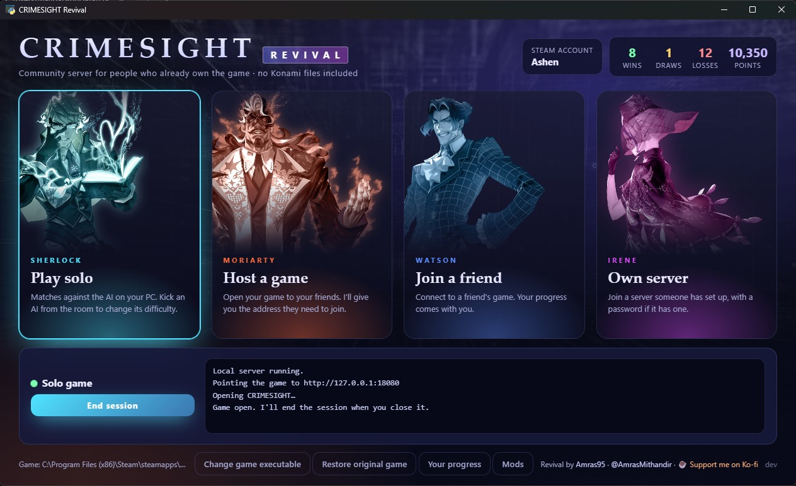
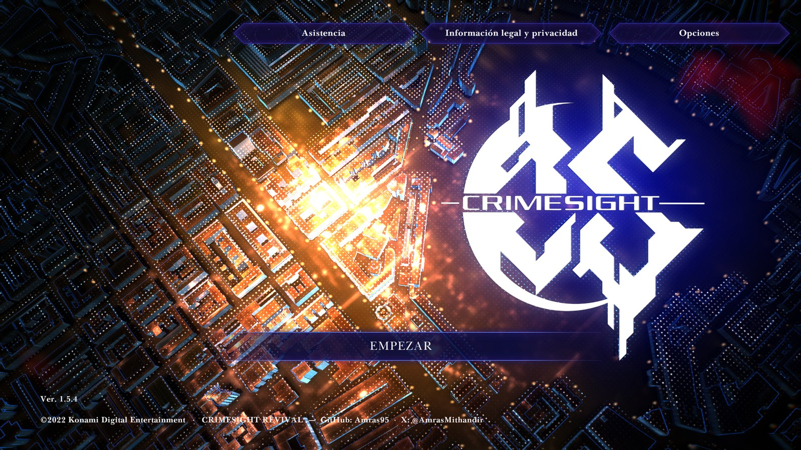
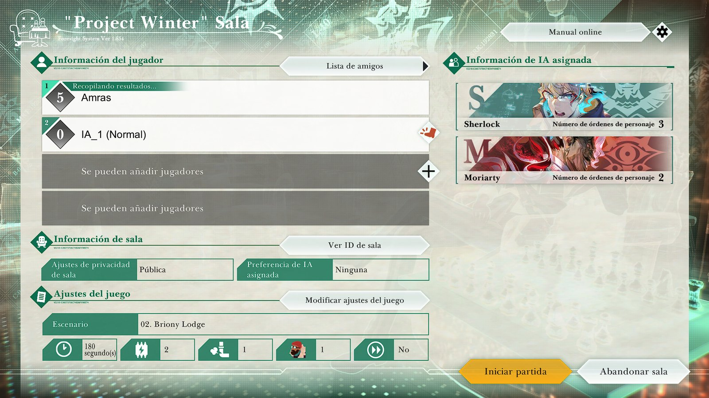
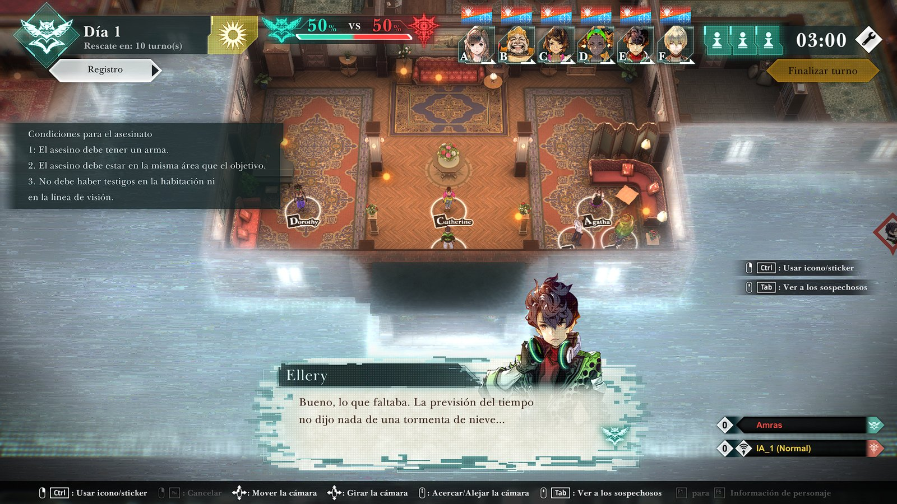

<p align="center"></p>

<h1 align="center">CRIMESIGHT Revival</h1>

<p align="center"><b>Español</b> · <a href="README.en.md">English</a></p>

<p align="center">
Vuelve a jugar a CRIMESIGHT (Konami, 2022) después del cierre de sus servidores oficiales.<br>
Play CRIMESIGHT (Konami, 2022) again after its official servers shut down.
</p>

<p align="center">
<a href="https://github.com/Amras95/crimesight-revival/releases/latest"><b>⬇ Descargar / Download</b></a> ·
<a href="https://ko-fi.com/amrasmithandir95">☕ Ko-fi</a>
</p>


<p align="center">

</p>

<p align="center">



</p>

---

> [!NOTE]
> **Probado y funcionando:** partidas en solitario contra la IA y partidas entre dos personas (anfitrión y
> amigo), también a través de Radmin VPN.
>
> **Mods de stickers y avatares:** probados en solitario, con y sin recarga en caliente. La descarga de los
> mods del anfitrión al unirse a su sala está probada en local, aún no entre dos personas.
>
> **Linux / Steam Deck:** versión nueva, aún en pruebas.
>
> **Aún sin probar con personas:** partidas con **Watson** o **Irene** (3 o 4 jugadores) y el servidor propio
> en un VPS. Deberían funcionar, pero si encontráis cualquier problema, contádmelo en
> [Issues](https://github.com/Amras95/crimesight-revival/issues) y lo arreglo.

- Proyecto de la comunidad, no oficial y sin ánimo de lucro. No está relacionado con Konami.
- **Necesitas tener CRIMESIGHT en tu biblioteca de Steam.** Aquí no se incluye ningún archivo, clave ni
  imagen del juego: todo se lee de tu propia instalación.
- **Este proyecto solo publica la herramienta.** No gestiona ni aloja servidores: cada jugador o grupo de
  amigos monta el suyo. Si alguien monta uno, que no cobre por entrar.
- Todo se puede deshacer con el botón «Dejar el juego original».

## Cómo jugar (paso a paso)

1. Ten **CRIMESIGHT instalado** desde Steam y **Steam abierto** con tu cuenta.
2. Descarga **`CrimeSightRevival.exe`** desde [la última versión](https://github.com/Amras95/crimesight-revival/releases/latest).
3. Ábrelo. La primera vez tarda unos segundos en preparar las claves y las ilustraciones a partir de tu
   copia del juego. Si Windows SmartScreen avisa ("Windows protegió su PC"), pulsa *Más información* →
   *Ejecutar de todas formas*: pasa con cualquier programa nuevo sin firma de pago.
4. Elige cómo jugar:

   | Opción | Para qué |
   |---|---|
   | **Jugar solo** | Partidas contra la IA en tu PC. |
   | **Ser anfitrión** | Tus amigos se conectan a tu PC. El lanzador intenta abrir el puerto del router y te da la dirección para pasársela. |
   | **Unirme a un amigo** | Escribes la dirección que te pase tu amigo anfitrión. |
   | **Servidor propio** | Entras en un servidor que haya montado alguien, con contraseña si la tiene. |

5. Pulsa el botón y el juego se abre solo. Al cerrar el juego, termina la sesión.

El lanzador se **actualiza solo** cada vez que se publica una versión nueva, y se muestra en el idioma
en que tienes el juego (los 11 idiomas del juego).

### En la sala

- Los huecos libres se llenan con **IA** (`IA_1 (Normal)`…). **Expulsa a una IA** para cambiar su
  dificultad: Normal → Difícil → Fácil → hueco libre para un amigo.
- Cuando entra un amigo, ocupa el sitio de una IA.

### Si tu amigo no puede entrar

Cuando eres anfitrión, tu router tiene que dejar pasar el puerto **18080 (TCP)**. El lanzador lo intenta
solo (UPnP); si tu router no lo permite:

- Ábrelo a mano en la configuración del router (reenviar el puerto 18080 TCP a la IP de tu PC), **o**
- Usad una red privada gratuita como **Radmin VPN** (la más sencilla), **Tailscale** o **ZeroTier**, y pásale a tu amigo la
  IP que te dé esa red (por ejemplo `100.64.1.2:18080`).

### Tu progreso

Tus partidas, victorias y puntos se guardan **en tu PC** (`%APPDATA%\CrimeSightRevival`), no en la carpeta
del juego: aunque lo desinstales o reinstales, no pierdes nada. Cuando juegas en el servidor de un amigo,
tu progreso se junta con el suyo al entrar y vuelve a tu PC al salir: nunca se duplica ni se pierde nada.

Con el botón **«Tu progreso»** del lanzador puedes:

- **Exportarlo / importarlo** en un archivo `.csrsave` para llevarlo a otro PC. Importar solo suma las
  partidas que falten, así que nunca duplica nada.
- Activar la **copia automática** en una carpeta de OneDrive, Google Drive o Dropbox: se guarda una copia
  al terminar cada sesión y, en otro PC, tu progreso vuelve solo al elegir la misma carpeta.

Steam Cloud no se usa porque el espacio en la nube de cada juego lo controla su editora.

## Mods: tus propios stickers y avatares

Añade stickers y avatares tuyos. **Son huecos nuevos**: los del juego (también los de pago, que siguen
dependiendo de tenerlos en Steam) no se tocan nunca.

1. En el lanzador, pulsa **Mods → Abrir carpeta de mods** (`%APPDATA%\CrimeSightRevival\mods`). Viene
   preparada con un mod de ejemplo y un `README.txt`.
2. Mete tus imágenes (PNG, JPG, WEBP…) en `stickers\` y/o `avatars\`. Puedes ponerlas directamente en la
   carpeta de mods o hacer una carpeta por mod (botón **Nuevo mod**) para tener varios packs.
3. Juega. El lanzador las mete en el juego antes de abrirlo.

```
mods\
  stickers\        01_saludo.png, ¡Buenas noches!.png…
  avatars\         yo.png
  Gatos\           otro mod: su propia carpeta stickers\ y avatars\ (+ mod.json opcional)
```

- **Cualquier imagen sirve.** Se ajustan solas al tamaño del juego (stickers de 128×128 con su borde blanco;
  avatares de 256×256 colocados como los originales). Una **lámina con muchos stickers** en cuadrícula se
  separa sola, y si la imagen no tiene transparencia se le quita el fondo. Los avatares que llegan hasta los
  bordes (un busto cortado, una foto) van en un círculo para que encajen en todos los marcos.
- **El mensaje del sticker** (lo que sale en el registro: «Amras: ¡Buenas noches!») es el nombre del archivo;
  un número delante (`01_`) solo sirve para ordenar. Para usar signos que Windows no deja en los nombres
  (`? : " *`), escríbelo en **Mods → Mensajes**. Se guarda en el `mod.json` del mod.
- **Activa o desactiva** cada mod desde la ventana de Mods.
- **En la sala de otro jugador**, antes de entrar sale un aviso con sus mods: **Descargar y unirme** o
  **No unirme**. Se descargan como temporales (`<id>+temp`), tus mods quedan en pausa durante la partida y
  al salir se borran los temporales y vuelven los tuyos. Si la sala no tiene mods, se entra sin ninguno:
  todos los jugadores tienen que tener exactamente la misma lista.
- Lo que tengas puesto en la rueda de stickers y el avatar elegido **se conservan** aunque añadas imágenes,
  cambies mensajes o se actualice el lanzador. Solo se quita un sticker si borras o renombras su imagen (el
  juego pone «Hola» en su hueco).

### Recarga en caliente (opcional, con BepInEx)

Sin nada más, cambiar de mods necesita volver a abrir el juego. Si quieres que los cambios aparezcan **con el
juego abierto**, pulsa **Mods → Recarga en caliente → Activar**:

- El lanzador descarga [BepInEx](https://github.com/BepInEx/BepInEx) (el cargador de mods oficial de los
  juegos de Unity, 34 MB) **de su GitHub y solo si lo activas**: no viene incluido. Lo instala en la carpeta
  del juego junto al plugin del proyecto. El primer arranque tarda un minuto mientras BepInEx se prepara.
- Mientras juegas, el lanzador vigila tu carpeta de mods: si añades una imagen, cambias un mensaje o
  activas/desactivas un mod, aparece en el juego en unos segundos. Si eres anfitrión, también le llega a tu
  sala; si estás en la sala de otro, recibes sus cambios.
- Los cambios nunca se aplican a mitad de partida (se esperan al menú), para que todos tengan la misma lista.
- **Quitar BepInEx** (o «Dejar el juego original») lo borra todo y el juego vuelve a estar como siempre.

## Qué funciona

- Inicio de sesión, perfil, tutorial, ajustes y nivel.
- Salas de 2 a 4 jugadores mezclando personas e IA (probado con 2 personas; con Watson/Irene humanos,
  **pendiente de probar**). IA para los cuatro papeles (Sherlock, Moriarty,
  Watson e Irene), con tres dificultades.
- Partidas completas: objetos, perros salvajes, escapes de gas, Asalto, turno final, asesinato,
  detención y deducción final, con la cinemática correcta para cada bando.
- Victorias, empates, derrotas y puntos. Ganar da 200 contra la IA fácil, 400 en normal, 800 en difícil y
  1000 contra otras personas; empatar o perder, la mitad; abandonar, 0. Extras por acciones: arreglar el
  cuadro eléctrico (+50), curar (+50), frustrar el Asalto (+100), gas lacrimógeno al asesino (+100) y acertar
  al asesino (+100); como Moriarty, matar con el Asalto (+50), provocar el apagón (+50), gasear a alguien
  (+50) y dejar K.O. a la víctima (+100).
- Recompensas por puntos y nivel como en el original. El evento Project Winter queda abierto con su
  avatar desbloqueado. El contenido Deluxe sigue dependiendo de tenerlo en Steam.
- Los logros de Steam se siguen consiguiendo (los gestiona el propio juego con Steam).
- Mods de stickers y avatares nuevos, compartidos con la sala, con recarga en caliente opcional.

## Plataformas

CRIMESIGHT solo salió para **Windows 10/11 (64 bits)**. En Mac no hay versión del juego.

### Linux / Steam Deck (en pruebas)

El juego funciona con **Proton**, y hay versión del lanzador para Linux: **`CrimeSightRevival-linux`** en
[la última versión](https://github.com/Amras95/crimesight-revival/releases/latest).

1. Descárgalo, dale permiso de ejecución (clic derecho → Propiedades → «Es ejecutable», o
   `chmod +x CrimeSightRevival-linux`) y ábrelo. En Steam Deck, desde el **modo escritorio**.
2. La interfaz se abre en tu **navegador** (es la misma que en Windows). Mientras la pestaña esté abierta,
   el lanzador sigue funcionando; si la cierras sin ninguna partida en marcha, se cierra solo.
3. Encuentra Steam y el juego solo (Steam normal, Flatpak o Snap) y abre el juego por Steam con Proton.

Los mods funcionan igual. Para la **recarga en caliente** (BepInEx), además hay que poner esto en las
**opciones de lanzamiento** de CRIMESIGHT en Steam (Propiedades → General); el lanzador te avisa si falta:

```
WINEDLLOVERRIDES="winhttp=n,b" %command%
```

## Montar un servidor (por ejemplo, en un VPS)

1. En tu PC, con el juego instalado: `python tools/extract_keys.py "<carpeta del juego>"`. Crea
   `server/keys.json` con las claves de **tu** copia. Súbelo al servidor junto con la carpeta `server/`.
2. En el servidor (Python 3.10+): `pip install aiohttp pycryptodome` y
   `python server.py --password UNA_CONTRASEÑA` (puerto 18080; ábrelo en el cortafuegos).
3. Los jugadores usan «Servidor propio» con `IP_O_DOMINIO:18080` y la contraseña.
4. Opcional: `--mods-dir CARPETA` ofrece a los jugadores los mods de esa carpeta (misma estructura que la
   carpeta de mods del lanzador; necesita `pip install pillow`).

La contraseña protege la sincronización de perfiles: el juego solo se identifica con su ID de Steam,
así que un servidor sin contraseña permitiría a cualquiera hacerse pasar por otro jugador.

## Para desarrolladores

- `4_lanzador.bat`: abre el lanzador con Python, sin compilar.
- `crear_exe.bat`: crea `dist\CrimeSightRevival.exe` (versión de desarrollo, no se actualiza sola).
- `plugin/`: código del plugin opcional de BepInEx y su `.dll` ya compilado. Se compila contra los ensamblados
  que genera BepInEx 6 (IL2CPP) en `BepInEx\interop` al arrancar el juego por primera vez; no se incluye
  ningún archivo del juego.
- Cada vez que se sube algo a `main`, GitHub Actions compila el `.exe` en Windows y publica una release
  (`.github/workflows/release.yml`). Los lanzadores instalados la descargan, comprueban su huella
  SHA-256 y se sustituyen solos.
- Scripts sin lanzador: `1_preparar.bat` (dependencias, claves y redirección), `2_servidor.bat` y
  `3_restaurar_juego_original.bat`.

### Cómo funciona por dentro

Unity 2020.3 con IL2CPP. La dirección del servidor (`https://cott-game.cs.konami.net`) se cambia en
`global-metadata.dat`. El tráfico va cifrado con AES-256-CBC; las claves están en `resources.assets` del
propio juego. La API es `POST /cott/api/index.php` y las partidas van por WebSocket con WAMP v2: el
servidor marca las fases del turno, reparte objetos y decide peligros y asesinatos; la simulación visual
va en el cliente. Extras del servidor comunitario: `POST /revival/sync` (perfiles), `GET /revival/info` y
`GET /revival/mods` (paquete de mods de la sala).

**Mods (`server/modpack.py`, `server/modimage.py`, `launcher/modinject.py`):**

- Los stickers son `StampData` en `resources.assets`; los gratuitos están en el `StampSet` 0. El juego los
  identifica por `tipo | cara` y en red manda la **posición** en la lista (`setIndex`, `dataIndex`), así que
  todos los jugadores de la sala necesitan la misma lista en el mismo orden. Cada sticker nuevo recibe un tipo
  de 1000 a 4095 (el juego usa 0-38) calculado a partir de la carpeta del mod y el nombre del archivo, de modo
  que es estable y el orden (el juego ordena por tipo) sale igual en todos los PCs.
- Los avatares son `CursorAvatarData` en `sharedassets3.assets`, listados por los `CursorAvatarSet` de las
  escenas `level3` (menú) y `level4` (partida); en red viajan por su nombre (`Icon_CSR_<hash>`).
- **Sin BepInEx**, `modinject.py` reconstruye esos archivos con UnityPy partiendo siempre de los originales
  (`*.original`): clona un `StampData`/`CursorAvatarData` de plantilla, añade textura RGBA32 incrustada y
  sprite de 4 vértices, y los añade al final de las listas. Los mensajes se añaden al texto del juego
  (`ctg_name`, en los 11 idiomas). Si la rueda o el avatar guardados (PlayerPrefs) apuntan a un mod que ya no
  está, se cambian por uno del juego.
- **Con BepInEx**, los archivos del juego se quedan originales: el lanzador escribe el conjunto de la sala en
  `BepInEx\csr_live\live.json` (en la carpeta del juego) y el plugin (`plugin/CrimeSightRevivalMods.cs`) crea los
  objetos en memoria (`Texture2D` + `Sprite.Create` + `ScriptableObject.CreateInstance`), los mete en las
  listas del juego y añade los textos a `TextManager.LangText`. Comprueba cada segundo y lo reaplica tras cada
  cambio de escena.
- Por la red viaja un zip interno con las imágenes ya ajustadas y validadas (tamaño, nombres, formato): el
  jugador nunca comprime nada.

## Licencia

[GPL-3.0](LICENSE) con [términos adicionales](ADDITIONAL_TERMS.md) (sección 7): hay que mantener la
atribución al autor y las versiones modificadas deben indicar que lo son y no hacerse pasar por la
original.

## Créditos

CRIMESIGHT Revival por **Amras95** · [GitHub](https://github.com/Amras95) · [X](https://x.com/AmrasMithandir) ·
[Ko-fi](https://ko-fi.com/amrasmithandir95)

El icono del lanzador es un diseño propio del proyecto. CRIMESIGHT es una marca de Konami Digital
Entertainment; este proyecto no está afiliado ni avalado por Konami.

## Aviso

Proyecto de preservación para quienes compraron el juego. Si Konami pide retirarlo, se retirará.
